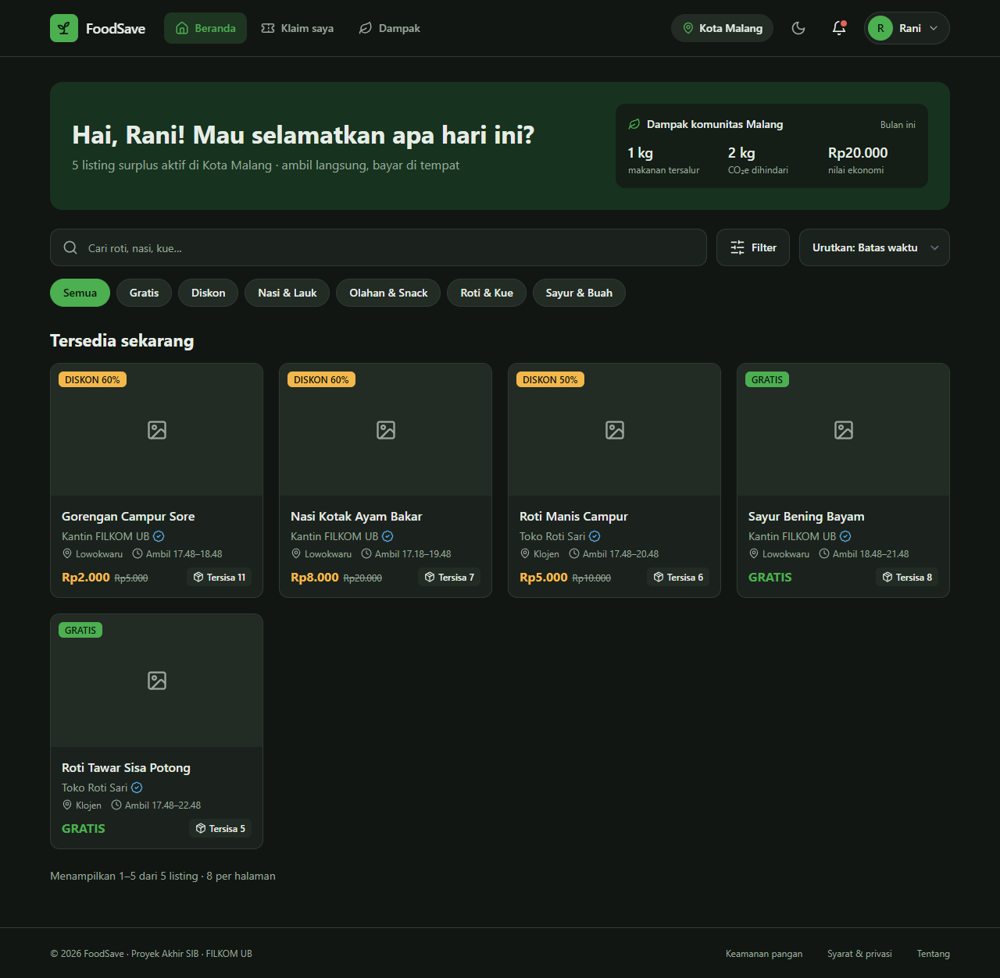
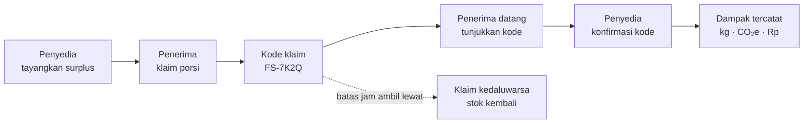
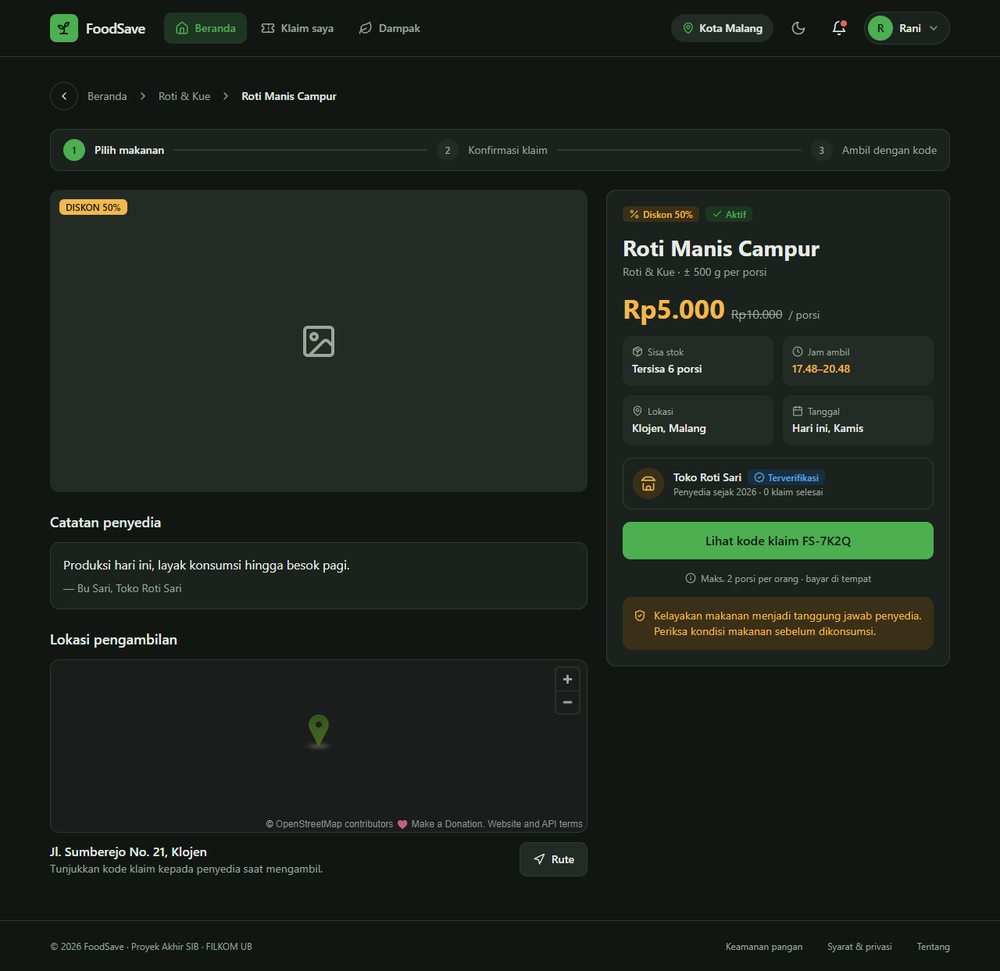
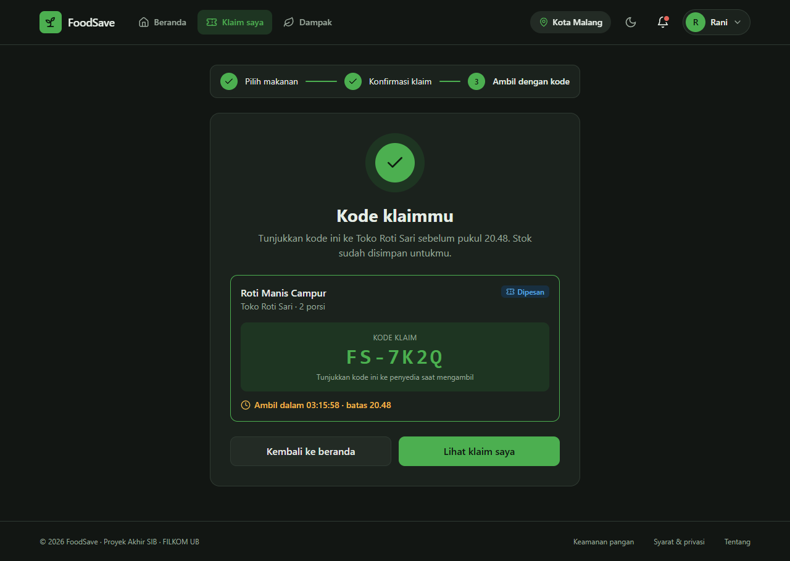
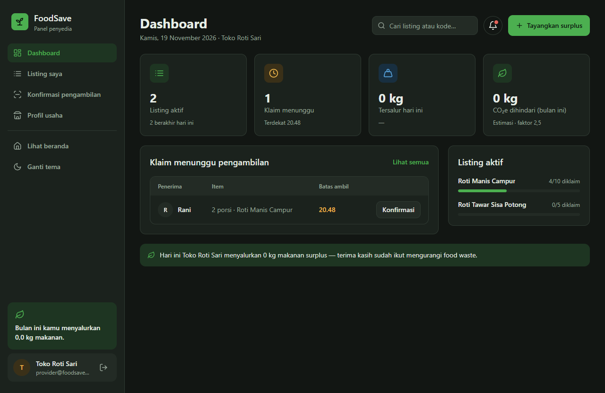
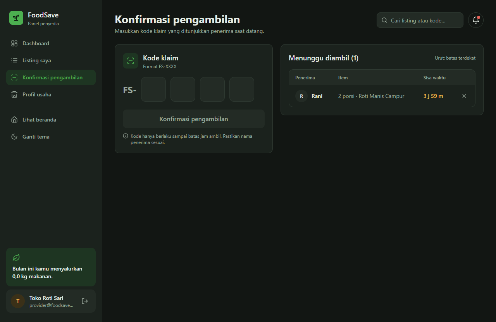
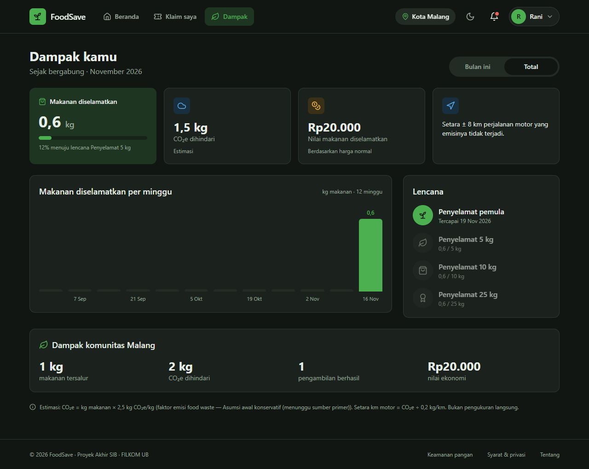
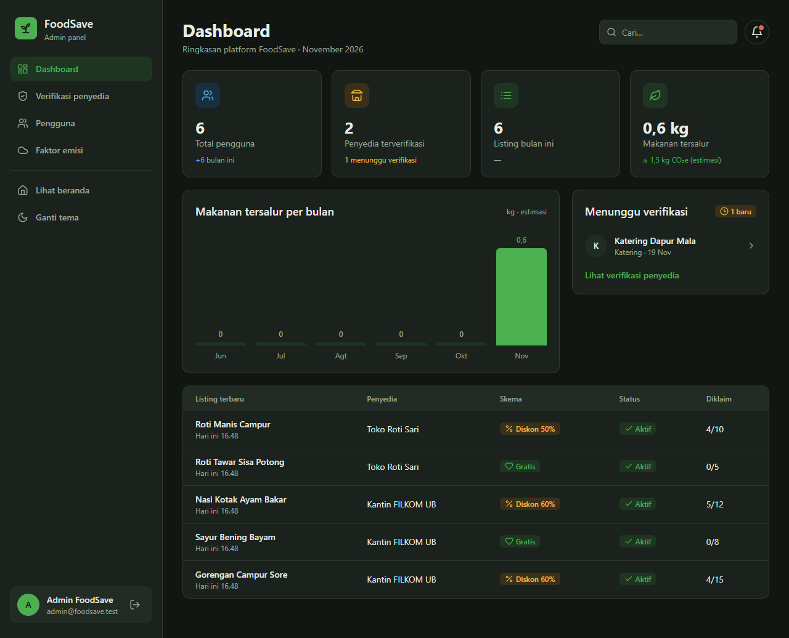
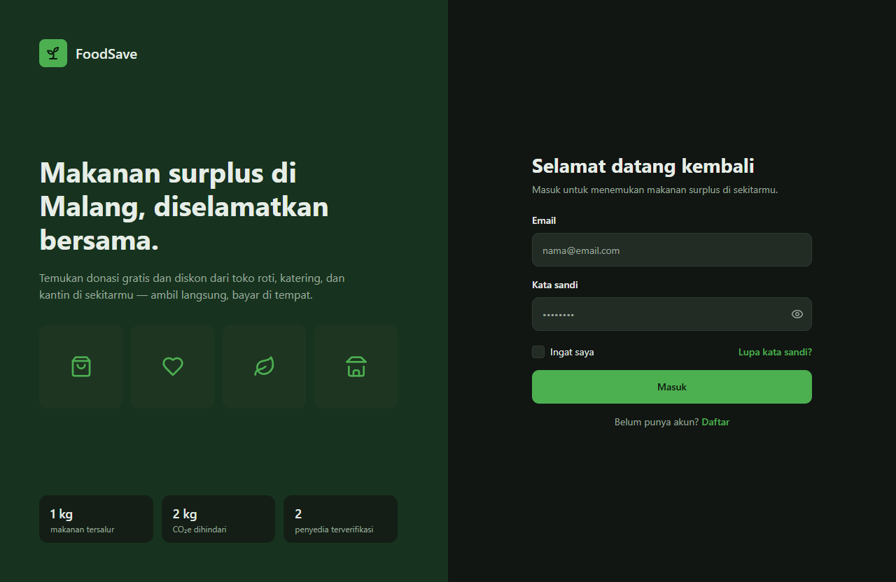
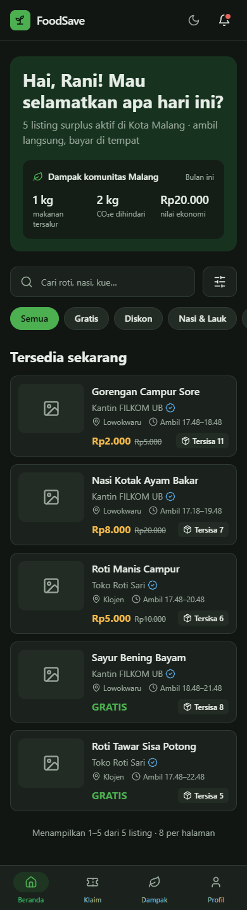

<div align="center">

# 🌱 FoodSave

**Platform penyaluran makanan surplus di Kota Malang — dari toko, katering, dan kantin langsung ke penerima, sebelum terbuang.**

[](https://laravel.com)
[](https://www.php.net)
[](https://tailwindcss.com)
[](https://alpinejs.dev)
[](#-pengujian)

[**Demo langsung**](https://foodsave.infinityfree.me) · [Fitur](#-fitur-utama) · [Cara kerja](#-cara-kerja) · [Instalasi](#-instalasi-lokal) · [Pengujian](#-pengujian)



</div>

---

## Tentang

Setiap hari, toko roti, katering, dan kantin kampus menyisakan makanan yang masih layak konsumsi namun tidak terjual. **FoodSave** menghubungkan surplus tersebut dengan penerima di sekitarnya: penyedia menayangkan makanan secara **gratis** atau **diskon**, penerima mengklaim porsi dan mengambilnya langsung dengan **kode klaim**, lalu setiap pengambilan tercatat sebagai **dampak** — kilogram makanan yang diselamatkan, estimasi emisi CO₂e yang dihindari, dan nilai ekonominya.

Proyek ini dikembangkan sebagai **Proyek Akhir Sistem Informasi Bisnis, Fakultas Ilmu Komputer, Universitas Brawijaya**, dengan desain UI/UX yang disusun terlebih dahulu di Figma (user flow → wireframe → design system → UI high-fidelity, mode gelap & terang).

> FoodSave tidak memproses pembayaran digital maupun pengantaran. Pembayaran (untuk skema diskon) dilakukan langsung di tempat.

## ✨ Fitur utama

| Penerima | Penyedia | Admin |
|---|---|---|
| Cari & filter listing (skema, kategori, urutan) | Onboarding profil usaha + titik lokasi | Verifikasi penyedia dengan daftar periksa |
| Detail listing dengan peta & rute | Tayangkan surplus dengan pratinjau kartu langsung | Kelola pengguna & peran |
| Klaim maks. 2 porsi, kode `FS-XXXX` + hitung mundur | Simpan draf, tutup, tayangkan ulang listing | Kelola faktor emisi (sumber & tahun) |
| Riwayat klaim & status kedaluwarsa | Konfirmasi pengambilan dengan input kode | Dashboard platform & grafik bulanan |
| Dashboard dampak pribadi, grafik mingguan, lencana | Statistik harian & bulanan usaha | |

**Lainnya:** mode gelap (default) & terang, responsif (desktop · tablet · mobile dengan tab bar), antarmuka berbahasa Indonesia, foto otomatis dikompres ke WebP ≤ 800 px.

## 🔄 Cara kerja



- **Anti-overselling** — klaim diproses dalam `DB::transaction` dengan `lockForUpdate`, sehingga dua penerima tidak bisa mengambil stok terakhir yang sama.
- **Kedaluwarsa otomatis** — listing dan klaim yang melewati batas jam ambil ditandai *expired* dan stoknya dikembalikan. Karena hosting tidak menyediakan cron, pengecekan berjalan di dalam request (maksimal sekali per menit).
- **Verifikasi penyedia** — penyedia baru hanya bisa menayangkan listing setelah disetujui admin.

### Perhitungan dampak

| Besaran | Rumus |
|---|---|
| Makanan diselamatkan (kg) | berat per porsi × jumlah porsi diambil |
| CO₂e dihindari (kg) | kg makanan × faktor emisi kategori (kg CO₂e/kg) |
| Nilai ekonomi (Rp) | harga normal × jumlah porsi |

Faktor emisi dapat diubah admin dan hanya berlaku untuk perhitungan baru. Seluruh angka dampak merupakan **estimasi**, bukan pengukuran langsung.

## 🖼️ Tampilan

| | |
|---|---|
|  |  |
| **Detail listing** — info stok, jam ambil, penyedia terverifikasi, peta | **Klaim berhasil** — kode klaim dan hitung mundur batas ambil |
|  |  |
| **Dashboard penyedia** — klaim menunggu & listing aktif | **Konfirmasi pengambilan** — input kode `FS-XXXX` |
|  |  |
| **Dampak** — statistik pribadi, grafik mingguan, lencana | **Admin** — ringkasan platform & verifikasi |

<details>
<summary>Masuk & tampilan mobile</summary>

<p>


</p>
</details>

## 🧱 Teknologi

| Lapisan | Teknologi |
|---|---|
| Backend | Laravel 12 (PHP 8.2+), Eloquent ORM, Laravel Breeze (autentikasi) |
| Frontend | Blade components, Tailwind CSS 3, Alpine.js 3, Vite |
| Basis data | MySQL / MariaDB (produksi), SQLite (pengembangan & pengujian) |
| Gambar | Intervention Image 3 (konversi WebP) |
| Peta | OpenStreetMap embed + tautan rute Google Maps |
| Hosting | InfinityFree (shared hosting, tanpa SSH/cron) |

### Model data

```
users ─┬─< provider_profiles ─< food_listings >─ food_categories >─ emission_factors
       └─< claims >──────────────────┘
              └── impact_logs (1:1)
```

| Tabel | Isi |
|---|---|
| `users` | akun dengan peran `receiver` · `provider` · `admin` dan status verifikasi |
| `provider_profiles` | nama, jenis, alamat, kecamatan, dan koordinat usaha |
| `food_listings` | skema gratis/diskon, harga, stok, jendela jam ambil, status, foto |
| `claims` | jumlah porsi, kode klaim, status `booked` · `picked_up` · `expired` · `cancelled` |
| `impact_logs` | kg, CO₂e dihindari, nilai ekonomi per pengambilan |
| `emission_factors` | nilai kg CO₂e/kg beserta sumber dan tahun |

## 🚀 Instalasi lokal

**Prasyarat:** PHP 8.2+ (ekstensi `gd`, `pdo_sqlite`), Composer 2, Node.js 18+.

```bash
git clone https://github.com/Yance30/foodsave.git
cd foodsave

composer install
npm install

cp .env.example .env
php artisan key:generate

touch database/database.sqlite
php artisan migrate --seed

npm run build
php artisan serve
```

Buka `http://127.0.0.1:8000`. Untuk pengembangan dengan hot reload, jalankan `npm run dev` di terminal terpisah.

### Akun demo (hasil seeder lokal)

| Peran | Email | Kata sandi |
|---|---|---|
| Penerima | `receiver@foodsave.test` | `password` |
| Penyedia (terverifikasi) | `provider@foodsave.test` | `password` |
| Penyedia (menunggu verifikasi) | `pending@foodsave.test` | `password` |
| Admin | `admin@foodsave.test` | `password` |

> ⚠️ Akun ini hanya untuk lingkungan lokal. Ganti kata sandinya sebelum data seeder dipakai di server publik.

## 🧪 Pengujian

```bash
php artisan test
```

**44 tes · 177 asersi** lulus. Pengujian fungsional *black-box* F-01–F-11 (`tests/Feature/FunctionalBlackBoxTest.php`) dipetakan ke Tabel 4.7 laporan — lihat [`docs/tabel-4-7.md`](docs/tabel-4-7.md).

| ID | Skenario | Hasil yang diharapkan |
|---|---|---|
| F-01 | Registrasi penyedia | Akun dibuat, menunggu verifikasi |
| F-02 | Admin memverifikasi penyedia | Penyedia baru bisa menayangkan listing setelah disetujui |
| F-03 | Penyedia membuat listing valid | Listing tayang di beranda |
| F-04 | Batas ambil di masa lalu | Ditolak dengan pesan validasi |
| F-05 | Cari & filter | Hasil sesuai filter |
| F-06 | Klaim melebihi stok | Ditolak, stok tidak negatif |
| F-07 | Dua klaim stok terakhir | Hanya satu yang berhasil |
| F-08 | Konfirmasi kode klaim | Kode salah ditolak, kode benar → `picked_up` + dampak tercatat |
| F-09 | Klaim melewati batas waktu | Status `expired`, stok kembali |
| F-10 | Agregasi dashboard dampak | Total kg, CO₂e, Rp sesuai data |
| F-11 | Unggah foto listing | Dikonversi ke WebP, sisi terpanjang ≤ 800 px |

`tests/Feature/FigmaFlowTest.php` menambah pengujian untuk batas 2 porsi per orang, format kode klaim, pembatasan klaim hanya untuk penerima, draf, penutupan listing, validasi harga diskon, dan render semua halaman utama.

## 🌐 Deploy (InfinityFree)

Hosting tidak menyediakan SSH, cron, maupun `storage:link`, sehingga aplikasi disusun ulang sebagai berikut:

```
htdocs/
├── index.php        # front controller → app-core/
├── .htaccess
├── build/           # aset hasil `npm run build`
├── uploads/         # foto listing (disimpan langsung di web root)
└── app-core/        # kode Laravel + vendor (akses web diblokir .htaccess)
    └── .env         # konfigurasi produksi — jangan ditimpa saat update
```

1. Jalankan `npm run build` dan `composer install --no-dev --optimize-autoloader`.
2. Unggah struktur di atas ke `htdocs`, isi `app-core/.env` (`APP_ENV=production`, `APP_DEBUG=false`, kredensial MySQL dari panel hosting).
3. Impor skema ke MySQL melalui phpMyAdmin.
4. Untuk pembaruan, unggah hanya `app-core/{app,config,lang,resources,routes,…}` dan `build/` **tanpa** `.env` dan `vendor/`, lalu kosongkan `app-core/storage/framework/views/`.

## 📁 Struktur proyek

```
app/
├── Http/Controllers/     # Home, Listing, Claim, Impact, Provider, Admin
├── Http/Middleware/      # EnsureRole, SweepExpiredListings
├── Models/               # User, ProviderProfile, FoodListing, Claim, ImpactLog, …
├── Services/             # ImpactCalculator, ListingExpiry, PhotoUpload
└── View/Components/      # AppLayout, PanelLayout, GuestLayout
resources/views/
├── layouts/              # app (penerima), panel (penyedia/admin), guest (masuk/daftar)
├── components/           # listing-card, claim-code-card, steps, badge, chip, icon, …
├── claims/ listings/ provider/ admin/ profile/ auth/
lang/id/                  # pesan validasi & autentikasi berbahasa Indonesia
tests/Feature/            # FunctionalBlackBoxTest, FigmaFlowTest, Auth
docs/                     # tabel pengujian & screenshot
```

## 🗺️ Pengembangan berikutnya

- Lokasi penerima & jarak (urutan "Terdekat", filter radius, emisi transportasi)
- Notifikasi dalam aplikasi untuk klaim baru dan status verifikasi
- Beberapa foto per listing dan unggah dokumen verifikasi usaha
- Pembatalan klaim oleh penerima dan status nonaktif pengguna

---

<div align="center">
<sub>Proyek Akhir Sistem Informasi Bisnis · Fakultas Ilmu Komputer · Universitas Brawijaya · 2026</sub>
</div>
